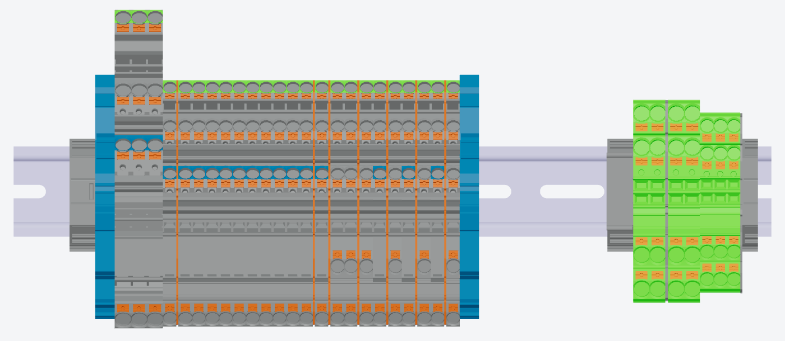

# Vetaion — Full-stack & UI/UX challenge

## Rail cutting & mounting guide

Vetaion builds electrical control cabinets. On our shop floor every workbench has a touchscreen
running our own software, which tells the operator what to do next: what to cut, which part to take
from the shelf, and where it goes.

In this challenge you design and build a simplified version of one of those screens.

Use any AI tools you like.

> **Confidential.** This challenge and everything that comes with it (the brief, the data, the
> code and the documents) is provided by **Vetaion GmbH** for your application only. The 3D models
> and product pictures remain the property of their manufacturers. Do not publish or share any of
> it, or your solution, with anyone other than the Vetaion recruiting team. That includes public
> repositories and public file-sharing links.

---

## 1. Background in two minutes

> New to electrical cabinets? Read **[docs/cabinets-101.md](docs/cabinets-101.md)** first. It is short.

- A cabinet has a steel **mounting plate**. Long metal **DIN rails** are mounted onto it.
  Components (terminals, circuit breakers, PLC modules…) **clip onto those rails**.
- We identify every rail and every component by its **BMK**, a device tag such as `-U1` or
  `-XD1:4`. It is the name on the part's label.
- Rails are bought as **raw bars** and **cut to length** at a bench.
- An operator builds one rail at a time: clip the parts on **from left to right**, in order.



---

## 2. Your task

Build a web app that guides an operator through **two steps**:

### Step 1 — Cut the rails

The operator cuts every rail the cabinet needs from raw bars.

- Show the list of rails to cut, with the information the operator needs.
- Show the cut piece in 3D (the lib does the cutting, see below).
- Let the operator mark a rail as cut. They should always know what is done and what is left.

### Step 2 — Mount the components

- The operator **chooses a rail** (any one of the cut rails) and starts assembling it.
- Guide them **part by part**: which part to take, what it looks like, and **where
  on the rail** it goes.
- **The data does not give the mounting order. Work it out from the components' 3D poses**
  ([how](docs/data-model.md#the-mounting-order-is-yours-to-work-out)).
- Show progress. Let them go back if they made a mistake.
- When a rail is finished, they move on to the next one, until every rail is done.
- They can stop partway through a rail, work on another, and come back to it later in the same
  session, from where they left off.

**What information does an operator need at each moment, and what should stay out of the way?**
That question is part of this challenge. Your task is to design software that makes the work easier
for the operator, so imagine doing the task yourself and ask what would make it easier for you.

### The operator and the screen

These are real constraints from our benches:

- The operator **interacts** with the software through a touchscreen between actions. Their hands and eyes are on the rail most of the time.
- Operators are skilled technicians, not software users. Keep the wording short and plain.

### Optional (only if you have time)

- **Data persistence:** progress survives a page reload.
- Anything else you think an operator would thank you for. Tell us why.

---

## 3. What you get

```
data/            the job, as JSON — see docs/data-model.md
  placement.json   the rails to cut, and the components placed on each, with their 3D pose
  catalog.json     one entry per article (manufacturer, article number, picture, 3D model, bar length)
assets/
  glb/             3D models (one per article)
  images/          product pictures (one per article)
lib/             a small 3D toolkit — see docs/lib.md
  core/            plain three.js, no framework
  react/           thin React Three Fiber wrappers over core/
demo/            a minimal reference for using the lib and the data (NOT a design reference)
tests/           tests for the lib and the data
```

### Run the demo

**Requirements**

- **Node.js 20.11 or newer.** The current LTS from [nodejs.org](https://nodejs.org) is fine. npm
  comes with it. Check with `node -v`.
- A browser with **WebGL** (any current Chrome, Edge or Firefox).

There is no build step: the demo runs on Vite's development server, which compiles the code as it
serves it.

**Steps**

1. Unzip the file we sent you.
2. Open a terminal in the unzipped folder (the one with `package.json`).
3. Install the dependencies (once):
   ```bash
   npm install
   ```
4. Start the demo:
   ```bash
   npm run demo
   ```
   It opens **http://localhost:5173/demo/index.html** in your browser. If no browser opens, paste
   that address in. Stop it with **Ctrl+C** in the terminal.
5. Optional, run the tests:
   ```bash
   npm test
   ```

In the demo, choose a rail at the top left. The slider adds or removes that rail's parts. Drag to
rotate, right-drag or two fingers to pan, and scroll or pinch to zoom.

**If something goes wrong**

- **Windows: "running scripts is disabled on this system"** when you type `npm` in PowerShell.
  PowerShell blocks npm's script by default. Use **Command Prompt** (`cmd`) instead, or type
  `npm.cmd install` and `npm.cmd run demo`.
- **"Port 5173 is in use":** Vite picks the next free port and prints the address. Open that one.
- **The page loads but the 3D area stays empty:** the browser has WebGL turned off, or the machine
  has no graphics support for it, as in some virtual machines. Try another browser.

You may build on these files or start from scratch. You may use **React, Vue, Svelte, plain JS,
or anything else**. `lib/core` has no framework dependency.

### The 3D lib

See **[docs/lib.md](docs/lib.md)**. In short:

- `cutRailModel(railGlb, cutLengthMm, barLengthMm)` turns a raw-bar GLB into the cut piece. It
  throws if the piece cannot be cut from the bar.
- `placeComponent(model, pose)` puts a component GLB at its pose on the rail.
- `createRailScene(container)` sets up a ready viewer (camera, lights, touch controls).

You do not need any 3D experience beyond calling these.

---

## 4. Database (optional, but preferred)

You may read the JSON files directly. We'd **prefer** you put the data in a database and query it
from the app. Use any platform: [Supabase](https://supabase.com) (free tier), SQLite,
PostgreSQL, Firebase, anything.

If you do:

- Design the schema yourself. The JSON files are a starting point, not the schema.
- Load the data with a script or a migration that we can run.
- Explain your schema in a few lines: what the tables are and why.
- Design for scale: assume the real data is far larger, and keep loading and querying fast.

---

## 5. What to send us

1. **Your work, as a zip file or a private Git repository** (GitHub, GitLab…) shared only with
   the Vetaion recruiting team, with clear run instructions. Leave `node_modules` out of a zip.
2. **`DECISIONS.md`**, one page at most:
   - the key UX decisions you made and why;
   - your data model (if you used a database);
   - what you would do next with more time;
   - which AI tools you used, and for what.
3. Optional: a short screen recording.

### What we look at

- **Clarity for the operator.** Does the screen say what to do next, at a glance? Is the step
  from one part to the next obvious?
- **Visual design.** Hierarchy, spacing, consistency, and touch-friendliness.
- **Data.** A sensible model, and sensible queries.
- **Code.** Readable, structured, and easy to change.
- **Communication.** How well you explain your choices.

---

## Questions?

Write to **[schtioui@vetaion.com](mailto:schtioui@vetaion.com)**. Asking a good question counts in your
favour.
